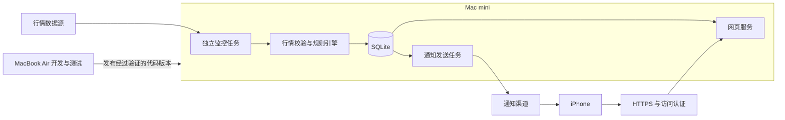

# Stock Copilot v0.1 架构草案

日期：2026-10-17。本文描述拟实现方案，不代表已经部署。

## 1. 部署拓扑

Mac mini 是正式运行实例，Air 使用独立的模拟数据和配置。同步代码版本，不跨设备同步正在写入的 SQLite 文件。

监控与网页独立运行，关闭网页不影响任务。mini 常开不等于永不睡眠；休眠、重启、用户登录依赖和断网恢复需要实机验证。

## 2. 技术选择

| 部分 | 当前建议 | 结论状态 |
|---|---|---|
| 核心业务 | Python 模块化单体 | 沿用原设计 |
| 存储 | SQLite，金额采用 Decimal 计算与明确的存储精度 | 沿用原设计 |
| 网页 | 先验证 Streamlit 的手机核心流程；不预先锁死框架 | 待原型验证 |
| 后台任务 | Python 命令入口，由 macOS launchd 管理 | 待 mini 验证 |
| 行情 | 统一 Provider 接口，模拟数据起步，随后验证真实源 | 待来源与权限验证 |
| 通知 | 优先验证微信渠道；通知适配器独立于规则 | 待手机验证 |
| 外网访问 | 受控 HTTPS 入口与单用户访问认证 | 待网络方案验证 |

若 Streamlit 无法满足手机导航、登录或事件详情跳转，再切换到轻量网页前端＋Python API。选择依据是实际流程，不提前引入复杂的微服务、消息队列或多数据库。

PWA 不是普通网页自动附带的能力。若进入范围，需要额外实现安装配置、Service Worker、订阅管理和 Web Push，并做 iPhone 测试。

## 3. 核心模块与数据

- `providers`：行情和日历适配，返回来源、报价时间、采集时间、币种、交易时段、延迟信息。
- `portfolio`：手动/CSV 账户快照录入、原子导入、金额计算、完整性标记；通过统一 Broker Adapter 保留券商同步扩展边界。
- `research_context`：用户手动维护的关注理由、投资期限、风险备注和复核日期；引用规则，不调用 LLM。
- `alerts`：有效性检查、规则状态机、冷却、事件生成。
- `notifications`：发送队列、渠道适配、有限重试、结果记录。
- `storage`：数据库迁移、事务、备份与恢复。
- `web`：页面、访问控制、详情链接和配置操作。
- `jobs`：定时入口、互斥、运行日志和健康状态。

核心实体：WatchlistItem、Quote、PriceHistory、ResearchContext、Account、PositionSnapshot、CashSnapshot、AlertRule、AlertState、AlertEvent、NotificationAttempt、JobRun。

同一标的支持多个独立规则及规则版本，事件保留触发时的规则快照。研究上下文与近期日收盘价通过股票详情展示；功能范围以 [PRD](PRD.md) 为准。券商自动同步只作可选探索，不阻塞 CSV 交付。

时间统一存 UTC，页面按用户选择的时区展示；交易日历使用 America/New_York。规则的有效报价判定必须考虑行情本身的时间，不能只看刚刚收到 HTTP 响应。

数据源若只有延迟行情，应明确展示延迟，并在接入验收中决定是否满足提醒用途。不可用时降级为展示，不假装实时监控成功。

## 4. 任务与一致性

1. 获取任务互斥锁，判断是否在监控时段。
2. 获取行情，验证标的、币种、价格、时段、时间和数据新鲜度。
3. 在事务中保存报价、更新规则状态并写入唯一事件。
4. 同一事务写入待发送记录，提交后才发送网络请求。
5. 保存服务响应、尝试次数和下一次重试时间。

规则状态、冷却时间和发送队列持久化，重启不重新生成已有事件。短事务与有界锁等待处理网页配置写入和后台写入，数据库不放在共享网络盘。

发送失败采用有限重试并设置事件过期时间，恢复网络后不批量发送已经失去时效的价格提醒。服务已接受但本地尚未记录时崩溃，若渠道不支持幂等，仍可能重复；不能声称端到端恰好一次。

同一轮部分标的失败不影响其他有效标的。任务记录开始、结束、最近成功和错误摘要。mini 整机离线时无法自报故障，独立外部监控留作后续增强。

## 5. 手机访问与通知

微信通知路径：mini 主动向推送服务发送事件摘要，由服务转发到手机。单纯发送通知不要求 mini 对公网开放入口。

手机在外网查看详情则需要独立的网络入口。第一版目标是无需额外手机 App，通过登录保护的 HTTPS 网址访问。网关服务、域名、成本、国内网络表现与微信内置浏览器兼容性均待验证。

未经认证的请求不能取得持仓、规则、通知历史和导出文件；通知链接不得携带长期访问凭证。第三方渠道只接收最小事件摘要。推送密钥和券商凭证不进入前端或代码仓库。

## 6. 发布与维护

Air 完成测试后，mini 部署明确的版本；保留上一版本与数据库备份。迁移前备份，回滚不能仅回退代码而忽略数据库结构。备份使用 SQLite 一致性备份机制，并定期验证可恢复。

开机启动采用哪种 launchd 模式，需要根据 mini 的用户会话、磁盘解锁与凭证读取方式确定，不能提前承诺无需登录即可恢复。

两台设备登录同一个 ChatGPT 账户，不等于建立远程操作能力。后续维护需要单独验证 SSH 或受支持的远程连接及对应授权。

## 7. 接入参考

以下链接用于后续验证，不代表服务账户已经开通：

- [PushPlus 渠道](https://pushplus.plus/doc/channel/)
- [PushPlus 额度与实名要求](https://pushplus.plus/doc/guide/use.html)
- [Apple WebKit：iOS 主屏幕网页推送](https://webkit.org/blog/13878/web-push-for-web-apps-on-ios-and-ipados/)
