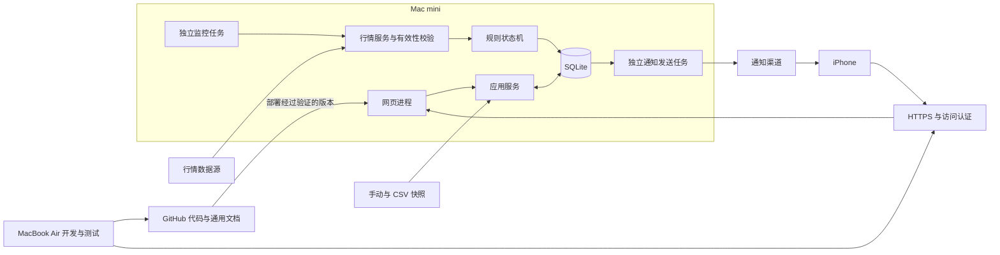

# Stock Copilot v0.1 技术架构设计

更新：2026-10-18。对照初始设计会话整理，并纳入后续确认的双机分工、iPhone 网页与微信提醒方案。本文区分目标架构和 M1 已实现原型；M1 页面原型于 2026-10-18 通过用户确认，保存为 `v0.1.0-m1`。接入方案仍需实测，iPhone Safari 真机与正式部署尚未验证。

功能范围和行为约定以 [PRD](PRD.md) 为准，包括行情过期判定、持仓与现金的独立导入范围、通知重试上限与有效期；开发时应同时落实，不能仅依据本文的架构摘要实现。

采用 Python 模块化单体：同一工程内组织行情、持仓、规则、存储和通知服务，网页与后台任务使用独立进程。第一版的首要流程是“有效报价进入用户配置区间 → 保存事件 → 手机提醒 → 网页查看”，规则由确定性代码执行，运行时不依赖 LLM。

| 初始设计内容 | 当前采用方式 |
|---|---|
| Python、Streamlit、Plotly、SQLite | 保留；前三者用于 M1，SQLite 从 M2 开始实现 |
| 本地定时任务与桌面通知 | 调整为常开 mini 独立监控、微信手机提醒；桌面通知不作为验收闭环 |
| yfinance 起步、Longbridge 后续、IBKR 读取持仓 | 保留 Provider/Adapter 边界；候选源未接入，权限、时效与稳定性须单独验证 |
| Pydantic、uv | 保留为后续模型校验、环境管理候选，尚未采用；不为整理文档改动当前依赖或锁文件 |
| 研究上下文与后续 AI 接口 | v0.1 只提供用户维护的备注与结构化数据，后续按授权扩展研究能力 |

## 1. 部署拓扑



Mac mini 是目标正式运行主机，Air 使用独立的模拟数据和配置。同步代码版本，不跨设备同步正在写入的 SQLite 文件。

监控与网页独立运行，关闭网页不影响任务。mini 常开不等于永不睡眠；休眠、重启、用户登录依赖和断网恢复需要实机验证。

## 2. 技术选择

| 部分 | 当前建议 | 结论状态 |
|---|---|---|
| 核心业务 | Python 模块化单体 | 沿用原设计 |
| 语言与测试 | Python 3.12、pytest | 当前本机环境已使用 |
| 存储 | SQLite，金额采用 Decimal 计算与明确的存储精度 | 沿用原设计 |
| 网页 | Streamlit 1.66.0 模拟数据原型；自定义桌面/手机导航 | M1 用户原型验收通过；Safari 真机仍待验证 |
| 图表 | Plotly，价格走势与持仓环形图 | 已实现模拟数据图表；全部主题/手机交互待验收 |
| 后台任务 | Python 命令入口，由 macOS launchd 管理 | 待 mini 验证 |
| 行情 | 统一 MarketDataProvider，模拟数据起步；yfinance、Longbridge 为候选 | 待来源、权限、时间与数据使用边界验证 |
| 持仓输入 | 手动/CSV 先行；统一 BrokerAdapter，Longbridge/IBKR 自动读取为可选探索 | CSV 与券商接口均未实现 |
| 通知 | 优先验证微信渠道；通知适配器独立于规则 | 待手机验证 |
| 外网访问 | 受控 HTTPS 入口与单用户访问认证 | 待网络方案验证 |
| 模型与环境 | 统一领域模型；Pydantic、uv 待评估，当前使用 venv/pip 与依赖快照 | 模型层从 M2 开始，M1 不引入新依赖 |
| AI | v0.1 不接入运行时 LLM；预留结构化研究上下文 | 设计边界，不是已实现 Agent |

若 Streamlit 无法满足手机导航、登录或事件详情跳转，再切换到轻量网页前端＋Python API。选择依据是实际流程，不提前引入复杂的微服务、消息队列或多数据库。

PWA 不是普通网页自动附带的能力。若进入范围，需要额外实现安装配置、Service Worker、订阅管理和 Web Push，并做 iPhone 测试。

M1 与目标架构的区别：状态暂存于各浏览器会话，报价、走势、持仓与事件均为人工构造；没有 SQLite、后台 Worker、认证或通知接入。默认原型监听本机回环地址 8501；显式启动手机预览时，独立 8502 服务仅绑定检测到的私有内网物理接口，供同一可信局域网内验证，不作为正式外网部署。启动与限制见 [手机验证](MOBILE_PREVIEW.md)。界面适配使用了 Streamlit 的内部样式选择器，依赖版本已固定，升级时需复查导航与布局。验证记录见 [M1 验证记录](M1_VALIDATION.md)。

外观与涨跌配色选择按浏览器会话保存，不修改进程级 Streamlit 配置，避免某设备切换影响其他设备。默认/初始配色与独立浅深主题配置一致；运行时通过 CSS 变量覆盖卡片、原生控件、弹出层及 Plotly 文字/网格。“跟随系统”使用浏览器媒体查询，手动模式固定调色板；升级 Streamlit 或 Plotly 后必须检查这些样式选择器，自动测试不替代视觉验收。

显示偏好与演示控制集中在独立设置页，业务页不重复创建这些控件；已保存值与临时控件状态分开，页面切换后控件被清理仍保留会话偏好，返回设置时恢复选中值。M1 不写入长期存储，刷新或重启后的恢复不能视为已实现。

### 2.1 服务边界与接口约定

以下为后续实现契约，不表示这些接口已经存在。网页负责展示、校验输入与调用应用服务，不在页面刷新中轮询行情、触发规则或发送通知。

| 边界 | 输入与输出 | 约束 |
|---|---|---|
| MarketDataProvider | 标的集合 → 逐标的 Quote/失败状态；历史走势单独读取 | 统一标的、币种、来源、行情时间、采集时间、时段和延迟信息；一个标的失败不丢弃整批有效结果 |
| BrokerAdapter | 手动/CSV/未来券商响应 → 标准化持仓与现金快照 | 持仓与现金分开预览确认；先校验后原子写入；不暴露订单接口 |
| AlertService | 有效报价＋规则版本＋持久状态 → 事件与新状态 | 与 UI/行情厂商/通知渠道无关；同一输入可独立测试 |
| NotificationAdapter | 最小事件摘要＋稳定详情入口 → 接受/失败/可重试结果 | 服务接受与用户已查看分开；不把接受请求当作手机送达 |
| Repository / Unit of Work | 领域对象与查询条件 → 存取结果、事务提交 | 不向业务服务泄露页面会话状态；对网页写入与后台写入提供一致的事务边界 |

行情与账户数据独立：未连接券商也可以管理关注列表和运行价格规则。走势数据与触发用报价独立校验，不能用最近一根日线或刚采集到的旧报价代替可触发的实时样本。行情候选源先用于展示验证，验证通过并配置最大报价年龄后才启用提醒。ChatGPT 中已有的券商连接不等于本地工程已建立 API 会话。

## 3. 核心模块与数据

- `providers`：行情和日历适配，返回来源、报价时间、采集时间、币种、交易时段、延迟信息。
- `portfolio`：手动/CSV 账户快照录入、原子导入、金额计算、完整性标记；通过统一 Broker Adapter 保留券商同步扩展边界。
- `research_context`：用户手动维护的关注理由、投资期限、风险备注和复核日期；引用规则，不调用 LLM。
- `alerts`：有效性检查、规则状态机、冷却、事件生成。
- `notifications`：发送队列、渠道适配、有限重试、结果记录。
- `storage`：数据库迁移、事务、备份与恢复。
- `web`：页面、访问控制、详情链接和配置操作。
- `jobs`：定时入口、互斥、运行日志和健康状态。

核心实体：WatchlistItem、Quote、PriceHistory、ResearchContext、Account、PositionSnapshot、CashSnapshot、AlertRule、AlertState、AlertEvent、NotificationAttempt、JobRun。

### 3.1 数据模型与关联

以下为 M2–M4 的字段设计基线，尚未创建正式数据库表。内部金额、数量和价格以 Decimal 运算，SQLite 以规范化十进制文本存取并在应用层校验，避免先存浮点再转换；图表绘制时才转换为浮点数。

| 实体 | 关键字段及关系 |
|---|---|
| WatchlistItem | 标准标的键（市场/代码）、中文显示名、英文名、启用状态；中文名可缺失并回退代码，不用名称关联数据 |
| Quote / PriceHistory | 标的、价格、币种、来源、行情时间、采集时间、交易时段、延迟标记；历史点另有周期与日期，不冒充最新报价 |
| Account / PositionSnapshot / CashSnapshot | 账户内部 ID/别名、券商标签、快照批次/时间/来源；持仓有标的/数量/平均成本，现金有币种/余额；账户＋标的在同批持仓中唯一 |
| ResearchContext | 标的、关注理由、投资期限、风险备注、明确复核时间；引用 AlertRule，不重复保存一份观察价格 |
| AlertRule | ID、标的、版本、名称、用途、上下界、启用状态、冷却分钟；变更条件产生新版本 |
| AlertState | 规则版本、最近有效内/外状态、最近处理报价标识、最近触发时间及冷却截止；数据无效不重置状态 |
| AlertEvent | ID、唯一触发标识、标的与名称快照、规则名称/用途/上下界/版本快照、触发价与来源时间、生成时间、已查看时间 |
| NotificationAttempt | 事件/发送记录 ID、渠道、状态、尝试序号、下次重试/过期时间、服务响应标识和脱敏错误；重试不新建价格事件 |
| JobRun | 任务类型、开始/结束/最近成功时间、处理数量和脱敏错误摘要 |

一只标的可有多条独立规则，一条规则版本对应持久状态并产生多条历史事件；一个事件可有多次发送尝试。删除关注项只停用关联规则并保留历史关联。未查看是事件阅读状态，不能从发送状态推导。

资产金额以 USD 为计算与存储基准，展示层支持 USD/CNY 切换；纯换算模块使用 Decimal，不回写原始持仓或现金，不改变规则币种、收益率及仓位占比。资产卡、相关持仓、分布图和不完整估值提示共用显示币种；报价、每股平均成本、价格走势、观察区间及触发价保留 USD。M1 仅使用公开标注的固定演示汇率 7.20，无网络请求；正式接入必须提供有效汇率及来源/时间，缺失时不能用演示值替代，不计算汇兑损益。

同一标的支持多个独立规则及规则版本，事件保留触发时的规则快照，包含用户设置的买入观察／卖出观察／观察用途；用途不改变区间判定，不改写历史事件。研究上下文与近期日收盘价通过股票详情展示；功能范围以 [PRD](PRD.md) 为准。券商自动同步只作可选探索，不阻塞 CSV 交付。

时间统一存 UTC，页面按用户选择的时区展示；交易日历使用 America/New_York。规则的有效报价判定必须考虑行情本身的时间，不能只看刚刚收到 HTTP 响应。

数据源若只有延迟行情，应明确展示延迟，并在接入验收中决定是否满足提醒用途。不可用时降级为展示，不假装实时监控成功。

## 4. 任务与一致性

目标运行三个入口：网页进程、约每五分钟启动的行情/规则任务、独立检查发送队列的通知任务。launchd 负责调度和进程恢复，应用负责美东交易日历、正常交易时段与互斥；通知重试不能被行情任务的五分钟周期阻塞。浏览器是否打开不参与调度。

1. 获取任务互斥锁，判断是否在监控时段。
2. 获取行情，验证标的、币种、价格、时段、时间和数据新鲜度。
3. 在事务中保存报价、更新规则状态并写入唯一事件。
4. 同一事务写入待发送记录，提交后才发送网络请求。
5. 保存服务响应、尝试次数和下一次重试时间。

规则状态、冷却时间和发送队列持久化，重启不重新生成已有事件。短事务与有界锁等待处理网页配置写入和后台写入，数据库不放在共享网络盘。

有效样本从区间外进入区间内时生成事件，持续处于区间内不重复；首次启用或修改条件后已经命中，按新版本生成一次“启用时已满足”事件。离开重入受冷却限制；冷却期内被抑制的重入不在结束时补发。重复处理同一报价由持久的报价标识、规则版本与唯一触发标识防重。多个重叠区间分别留事件，同轮通知可以合并摘要。

报价校验、状态转换和通知策略的完整边界以 PRD 第 5 节为准。时间由可替换时钟提供，测试使用固定时钟与人工行情，不依赖真实账户或联网。

发送失败采用有限重试并设置事件过期时间，恢复网络后不批量发送已经失去时效的价格提醒。服务已接受但本地尚未记录时崩溃，若渠道不支持幂等，仍可能重复；不能声称端到端恰好一次。

默认首次失败后约 1 分钟、5 分钟重试，总计最多三次；事件投递有效期为触发后 15 分钟，不因重启或重试延长。认证/配置错误不自动重试。队列保存下次尝试和截止时间，每次请求前再次判断是否仍可发送。

同一轮部分标的失败不影响其他有效标的。任务记录开始、结束、最近成功和错误摘要。mini 整机离线时无法自报故障，独立外部监控留作后续增强。

## 5. 手机访问与通知

微信通知路径：mini 主动向推送服务发送事件摘要，由服务转发到手机。单纯发送通知不要求 mini 对公网开放入口。

手机在外网查看详情则需要独立的网络入口。第一版目标是无需额外手机 App，通过登录保护的 HTTPS 网址访问。网关服务、域名、成本、国内网络表现与微信内置浏览器兼容性均待验证。

未经认证的请求不能取得持仓、规则、通知历史和导出文件；通知链接不得携带长期访问凭证。第三方渠道只接收最小事件摘要。推送密钥和券商凭证不进入前端或代码仓库。

## 6. 发布与维护

Air 完成测试后，mini 部署明确的版本；保留上一版本与数据库备份。迁移前备份，回滚不能仅回退代码而忽略数据库结构。备份使用 SQLite 一致性备份机制，并定期验证可恢复。

开机启动采用哪种 launchd 模式，需要根据 mini 的用户会话、磁盘解锁与凭证读取方式确定，不能提前承诺无需登录即可恢复。

两台设备登录同一个 ChatGPT 账户，不等于建立远程操作能力。后续维护需要单独验证 SSH 或受支持的远程连接及对应授权。

原设计提出的 SSH/Tailscale 是设备维护候选，尚未配置，不是 iPhone 必须安装的组件；维护连接与面向手机浏览器的 HTTPS 入口分别验证。代码通过 GitHub 同步，真实数据库、凭证、日志与备份仅留受保护的私有运行目录；不向远程仓库同步这些文件。

### 6.1 工程结构与演进顺序

当前 M1：`app.py` 与 `views/` 为页面入口；`src/stock_copilot/ui.py` 组合页面；`demo.py` 仅提供人工数据、会话编辑和纯计算；`currency.py`、`charts.py`、`theme.py` 分别负责换算、绘图和显示偏好；`tests/` 与 `scripts/` 提供测试和启动。目录现状不代表已具备持久化服务分层。

目标结构随对应里程碑建立，不先创建空目录：

```text
src/stock_copilot/
  domain/          领域模型、标的标识、枚举、金额与时间约束
  providers/       行情与日历接口及适配器
  brokers/         手动/CSV 及后续可选只读券商适配器
  services/        行情、持仓、研究上下文和提醒用例
  storage/         SQLite 迁移、仓储与事务
  notifications/   渠道适配器和发送队列处理
  jobs/            行情/规则、通知任务入口与互斥
  ui.py            当前网页呈现，配合根目录 views/ 入口调用应用服务
```

M2 实现领域对象、存储与确定性状态机；M3 实现手动/CSV、真实行情适配和新鲜度校验；M4 验证微信渠道、访问保护、稳定事件链接和手机实际接收；M5 验证 mini 启动、日志、备份及恢复。阶段边界与状态见 [路线图](ROADMAP.md)。

### 6.2 验证与故障恢复

- 单元测试：金额、CSV 原子覆盖、报价新鲜度、启用命中/离开重入/冷却/无效数据、有限重试和到期停止。
- SQLite 集成测试：唯一事件、并发配置更新、任务中断与重启后继续处理；备份和迁移回滚实际恢复。
- 页面测试：跨页数据一致、筛选范围、中文名/代码、币种与显示偏好；桌面和手机视觉检查独立记录。
- 端到端验收：mini 监控 → 事件 → 渠道 → iPhone 实际收到 → 认证详情 → 标记已查看；Air 合盖、断网、重启场景须实机检查。

仅使用人工构造的测试数据与隔离存储，测试服务不发送真实通知。行情权限、交易日历、手机到达率、远程连接和无人值守恢复均不能由 Mock 测试代替。

## 7. 后续 AI 扩展与安全边界

后续 AI Research 可通过只读查询服务取得带来源/时间的行情、持仓摘要、规则事件与研究上下文；这些是拟议的接口边界，v0.1 不提前实现 Agent 框架、在线模型或额外对外 API。未来替换前端也复用同一领域与应用服务。

研究解释与规则执行分离：模型可以解释事件或辅助研究，不能替代确定性区间判断；发送私人上下文到外部模型前需要单独确认数据范围与授权。开发工具订阅不等于程序模型 API 额度。

应用不实现下单、改单、撤单接口。未来券商 SDK 即使同时包含交易方法，也只通过隔离的读取适配器暴露已允许查询；调用只读方法不证明底层凭证仅有只读权限，实际授权范围必须核验。密钥不进入前端，私有响应与研究数据不上传 GitHub 或外部审查。公开材料边界见 [上传约定](REPOSITORY_POLICY.md)。

## 8. 接入参考

以下链接用于后续验证，不代表服务账户已经开通：

- [PushPlus 渠道](https://pushplus.plus/doc/channel/)
- [PushPlus 额度与实名要求](https://pushplus.plus/doc/guide/use.html)
- [Apple WebKit：iOS 主屏幕网页推送](https://webkit.org/blog/13878/web-push-for-web-apps-on-ios-and-ipados/)
